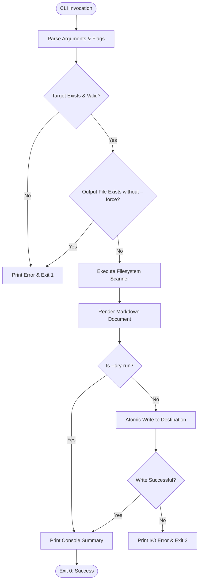
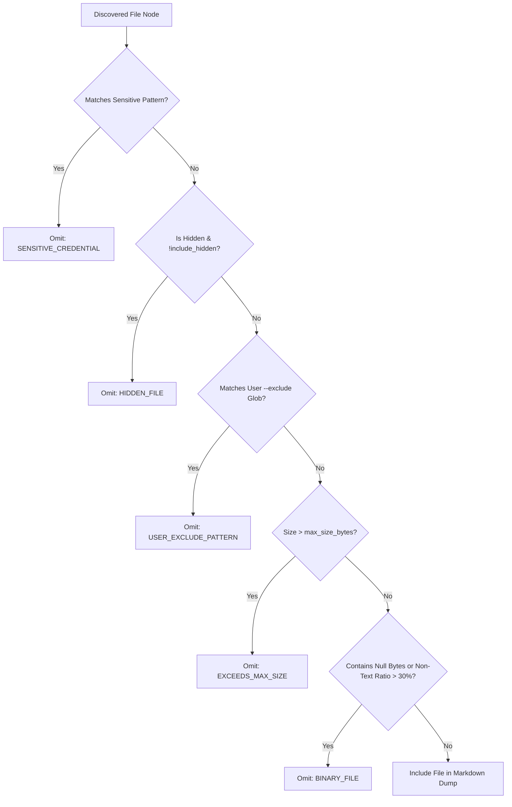

# Detailed Design Document (DRD): CodeDumper

**Document Version:** 1.0.0  
**Status:** Approved  
**Author:** Engineering Team  
**File:** `docs/DRD.md`  

---

## 1. Architecture Overview

CodeDumper is engineered as a clean, modular Unix-philosophy pipeline:
```
CLI Args -> Configuration -> Scanner -> Filter Engine -> Classifier -> Tree Builder -> Markdown Renderer -> Atomic Writer -> Report
```
Every phase is encapsulated in an isolated module with single responsibility, explicit type contracts, zero global state, and testable interfaces.

---

## 2. Directory Structure

The repository structure cleanly accommodates both the new `codedumper` package and the complementary `autocommit` package:

```
code_dumper/
├── .gitignore
├── pyproject.toml              # Modern build configuration and CLI entry points
├── requirements.txt            # Base development and testing dependencies
├── Readme.md                   # Primary project user guide & quickstart
├── codedumper/                 # Core CodeDumper package
│   ├── __init__.py             # Version metadata
│   ├── __main__.py             # Enables python -m codedumper execution
│   ├── cli.py                  # CLI argument parsing and process orchestration
│   ├── models.py               # Immutable dataclasses and domain entities
│   ├── scanner.py              # Recursive deterministic filesystem traversal
│   ├── filter.py               # Multi-tier exclusion engine (noise, secrets, globs)
│   ├── classifier.py           # Text vs. binary detection and syntax tagging
│   ├── tree.py                 # Hierarchical ASCII/Unicode directory tree renderer
│   ├── renderer.py             # Markdown serialization with dynamic code fencing
│   ├── writer.py               # Atomic filesystem writer with overwrite guards
│   └── reporter.py             # Execution statistics and omission manifest formatting
├── autocommit/                 # Preserved companion git-automation package
│   ├── __init__.py
│   ├── config.py
│   ├── git_ops.py
│   ├── state.py
│   └── watcher.py
├── docs/                       # Formal engineering specification documents
│   ├── ASSESSMENT.md           # Initial repository assessment
│   ├── PRD.md                  # Product Requirements Document
│   ├── ERD.md                  # Entity Relationship Diagram & Data Model
│   ├── TRD.md                  # Technical Requirements Document
│   ├── DRD.md                  # Detailed Design Document (this file)
│   ├── EDR.md                  # Engineering Design Review
│   └── TRACEABILITY.md         # Requirements Traceability Matrix
└── tests/                      # Automated test suite
    ├── __init__.py
    ├── test_autocommit.py      # Regression tests for auto-commit package
    └── test_codedumper.py      # Comprehensive unit & integration tests for CodeDumper
```

---

## 3. Module Design & Contracts

### 3.1 `codedumper.models`
- **Responsibility:** Defines domain dataclasses and enumerations.
- **Key Entities:**
  - `ScanConfig`: Immutable configuration container (`target_dir`, `output_path`, `max_size_bytes`, `include_hidden`, `exclude_patterns`, `force`, `dry_run`, `no_tree`).
  - `FileItem`: Represents a candidate file (`path: Path`, `rel_path: str`, `size: int`, `is_text: bool`, `language: str`).
  - `OmissionRecord`: Represents an excluded item (`rel_path: str`, `reason: str`, `size: int`).
  - `ScanResult`: Aggregated result (`included_files: List[FileItem]`, `omitted_files: List[OmissionRecord]`, `tree_text: str`, `elapsed_seconds: float`).

### 3.2 `codedumper.filter`
- **Responsibility:** Implements exclusion rules and precedence logic.
- **Signatures:**
  ```python
  class ExclusionEngine:
      def __init__(self, user_patterns: List[str], include_hidden: bool = False): ...
      def should_skip_directory(self, dir_name: str, rel_path: str) -> Optional[str]: ...
      def should_skip_file(self, file_name: str, rel_path: str, file_size: int, max_size: int) -> Optional[str]: ...
  ```
- **Rules Precedence:**
  1. Sensitive file patterns (`.env*`, `*.pem`, `*.key`, `id_rsa*`) -> Reason: `SENSITIVE_CREDENTIAL`
  2. Built-in build/VCS noise (`.git`, `node_modules`, `dist`, `__pycache__`) -> Reason: `DEFAULT_NOISE`
  3. Hidden path segment (`.*`) -> Reason: `HIDDEN_FILE` (if `include_hidden=False`)
  4. User custom glob match -> Reason: `USER_EXCLUDE_PATTERN`
  5. File size exceeds threshold -> Reason: `EXCEEDS_MAX_SIZE`

### 3.3 `codedumper.classifier`
- **Responsibility:** Differentiates text files from binary files; resolves syntax highlight tags.
- **Signatures:**
  ```python
  def is_binary_file(file_path: Path, sample_size: int = 8192) -> bool: ...
  def detect_language(file_path: Path) -> str: ...
  def read_text_safely(file_path: Path) -> Tuple[str, str]: ...
  ```
- **Algorithm:**
  - Read up to 8,192 bytes.
  - If null byte `b'\x00'` exists in sample, classify as binary.
  - Compute non-text byte ratio (bytes not in ASCII printable, newline, CR, tab, or valid UTF-8 lead sequences). If > 30%, classify as binary.
  - Text reading attempts `utf-8`; falls back to `utf-8` with `errors='replace'` or `latin-1`.

### 3.4 `codedumper.tree`
- **Responsibility:** Generates an ASCII/Unicode hierarchy tree showing directory structure.
- **Signature:**
  ```python
  def generate_directory_tree(root_dir: Path, filter_engine: ExclusionEngine) -> str: ...
  ```
- **Formatting:** Uses standard branch glyphs (`├── `, `└── `, `│   `). Preserves alphabetical sorting.

### 3.5 `codedumper.renderer`
- **Responsibility:** Generates Markdown content with dynamic code fence sizing.
- **Signature:**
  ```python
  def calculate_code_fence(content: str) -> str: ...
  def render_markdown(config: ScanConfig, scan_result: ScanResult) -> str: ...
  ```
- **Fence Algorithm:**
  Scans `content` for consecutive backticks. If max consecutive count is `k`, uses `max(3, k + 1)` backticks for enclosing fence. For example, if file contains ```` ```python ````, fence uses ```` ```` ````.

### 3.6 `codedumper.writer`
- **Responsibility:** Manages safe atomic disk writes and overwrite protection.
- **Signature:**
  ```python
  def write_dump_file(output_path: Path, content: str, force: bool = False) -> None: ...
  ```
- **Algorithm:**
  - If `output_path.exists()` and not `force`, raises `FileExistsError`.
  - Creates parent directories if missing (`output_path.parent.mkdir(parents=True, exist_ok=True)`).
  - Writes to temporary file: `output_path.with_name(f".tmp.{os.getpid()}.{output_path.name}")`.
  - Uses `os.replace(temp_path, output_path)` for atomic replacement.
  - On exception, unlinks temp file.

### 3.7 `codedumper.cli`
- **Responsibility:** Entry point parsing arguments, handling signals, coordinating pipeline, formatting terminal output, and returning exit codes.
- **Signature:**
  ```python
  def main(args: Optional[List[str]] = None) -> int: ...
  ```

---

## 4. Workflows (Mermaid Diagrams)

### 4.1 CLI Execution Workflow



### 4.2 File Classification & Filtering Workflow



---

## 5. Security & Safety Design

1. **Path Traversal Shielding:** Resolves paths via `.resolve()` and calculates relative paths with `.relative_to()`. Paths attempting traversal outside the target root raise validation errors.
2. **Zero In-Place Modification:** The target directory is strictly opened in read-only mode (`open(..., 'rb')`). No index or lock files are deposited inside target repository.
3. **Atomic Writes:** Prevents incomplete or corrupt files from persisting if process is killed or disk fills up.
4. **Credential Blacklist:** Built-in pattern table covers `.env*`, `*.pem`, `*.key`, `id_rsa*`, `credentials.json`, `*.p12`, `*.pfx`, `*.cer`.

---

## 6. Design Trade-Offs

- **Standard Library vs. Third-Party Libraries (e.g., Click, Rich, Pathspec):**
  *Decision:* Standard library (`argparse`, `pathlib`).
  *Rationale:* Zero-dependency CLI ensures instant installation and zero supply chain vulnerabilities.
- **In-Memory Rendering vs. Full Streaming:**
  *Decision:* Render files into structured in-memory string and write to file.
  *Rationale:* Bounded memory footprint (individual files are capped at 1 MB by default; 1,000 text files occupy ~15-30 MB in memory). Allows atomic file replacement and SHA-256 integrity calculation before disk commit.
