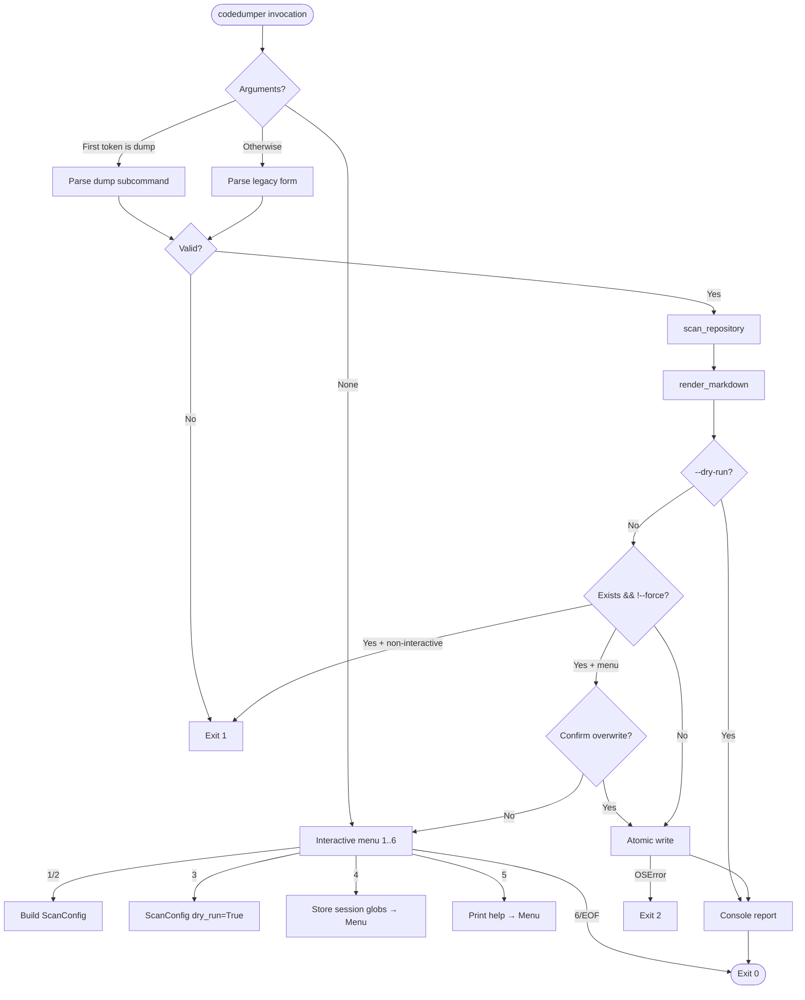
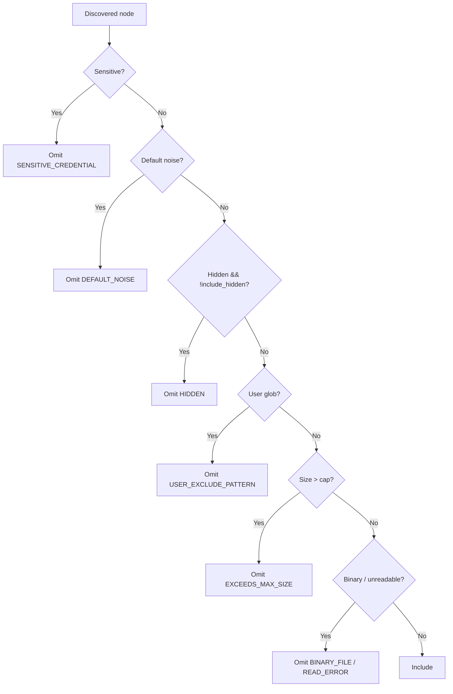

# Detailed Design Document (DRD): CodeDumper

**Document Version:** 2.0.0
**Status:** Approved
**Author:** Engineering Team
**Source of Truth:** `README.md` + `docs/PRD.md` + `docs/TRD.md` (v2.0.0)
**File:** `docs/DRD.md`

---

## 1. Architecture Overview

```text
 bare `codedumper` ──▶ interactive menu ──▶ ScanConfig ──┐
 `codedumper dump …` ──▶ subcommand parser ──▶ ScanConfig ─┤
 legacy `codedumper …` ──▶ legacy parser ──▶ ScanConfig ───┘
                                                        ▼
 Scanner ──▶ Filter Engine ──▶ Classifier ──▶ Tree Builder ──▶ Markdown Renderer ──▶ Atomic Writer ──▶ Reporter
```

Single-responsibility modules, one-way data flow through immutable
dataclasses, zero global state, zero runtime third-party imports. Per README
("do not create unnecessary modules"), the suggested `exporter/exclusions/
safety/config.py` files are **not** created; their responsibilities map onto
existing modules (§3.8).

---

## 2. Directory Structure

```text
code_dumper/
├── LICENSE                       # MIT license text (NFR-011)
├── README.md                       # normative user contract
├── pyproject.toml                  # build + `codedumper` entry point
├── requirements.txt                # dev/companion pins
├── run_watcher.py                  # companion launcher (untouched contract + --config)
├── codedumper/
│   ├── __init__.py                 # version + public exports
│   ├── __main__.py                 # `python -m codedumper`
│   ├── cli.py                      # menu + dump/legacy parsers + orchestration (TR-001/002/007/009/010/012)
│   ├── models.py                   # ScanConfig / FileItem / OmissionRecord / ScanResult
│   ├── scanner.py                  # sorted recursion + ingestion (TR-003)
│   ├── filter.py                   # precedence chain (TR-008)
│   ├── classifier.py               # binary/language/encoding (TR-006)
│   ├── tree.py                     # Project Structure tree (TR-004)
│   ├── renderer.py                 # Markdown: title/tree/File sections/Excluded Files (TR-005/011)
│   ├── writer.py                   # atomic write + overwrite guard (TR-009)
│   └── reporter.py                 # console summary (TR-011)
├── autocommit/                     # preserved companion (out of CodeDumper scope)
├── docs/                           # PRD/ERD/TRD/DRD/EDR/TRACEABILITY/ASSESSMENT
└── tests/
    ├── test_codedumper.py          # engine + legacy CLI tests
    └── test_codedumper_contract.py # v2 contract: dump/menu/format tests
```

---

## 3. Module Design & Contracts

### 3.1 `models` — domain entities

```python
@dataclass(frozen=True)
class ScanConfig:
    target_dir: Path
    output_path: Path
    max_size_bytes: int = 1_048_576
    include_hidden: bool = False
    exclude_patterns: list[str] = field(default_factory=list)
    force: bool = False
    dry_run: bool = False
    no_tree: bool = False

@dataclass(frozen=True)
class FileItem:
    path: Path; rel_path: str; size: int
    content: str; language: str; line_count: int

@dataclass(frozen=True)
class OmissionRecord:
    rel_path: str; reason: str; size: int = 0

@dataclass
class ScanResult:
    project_name: str; target_dir: Path
    included_files: list[FileItem] = field(default_factory=list)
    omitted_files: list[OmissionRecord] = field(default_factory=list)
    tree_text: str = ""
    elapsed_seconds: float = 0.0      # console-only; never rendered to file
    total_files_discovered: int = 0
```

### 3.2 `filter` — precedence engine (TR-008)

```python
class ExclusionEngine:
    def __init__(self, user_patterns: list[str] | None = None,
                 include_hidden: bool = False): ...
    def should_skip_directory(self, dir_name: str, rel_path: str) -> str | None: ...
    def should_skip_file(self, file_name: str, rel_path: str,
                         file_size: int, max_size_bytes: int) -> str | None: ...
```

Order: sensitive → default noise → hidden → user globs → size.
(Binary/encoding is the classifier's gate, applied after.)

### 3.3 `classifier` — safety checks (TR-006)

```python
def is_binary_bytes(data: bytes, suffix: str = "", sample_size: int = 8192) -> bool: ...
def is_binary_file(file_path: Path, sample_size: int = 8192) -> bool: ...  # delegates to is_binary_bytes
def detect_language(file_path: Path) -> str: ...   # ext map, fallback "text"
def decode_bytes_safely(raw_bytes: bytes) -> tuple[str, str]: ...  # utf-8 → latin-1 → utf-8/replace
def read_text_safely(file_path: Path) -> tuple[str, str]: ...      # reads, then delegates
```

The scanner reads each file once and classifies/decodes the bytes in memory
(one open per file instead of two). Verdicts are identical to the
path-based functions, which remain as the public/tested API.

### 3.4 `tree` — structure view (TR-004)

```python
def generate_directory_tree(root_dir: Path, filter_engine: ExclusionEngine,
                            max_depth: int = 25) -> str: ...
```

Glyphs `├── └── │   `, dirs suffixed `/`, sorted identically to the scanner.
Shows eligible layout including omitted paths (noise pruned); sensitive
**names** may appear in the tree but their **contents** are never embedded.

### 3.5 `renderer` — Markdown serialization (TR-005/011)

```python
def calculate_code_fence(content: str) -> str: ...  # "`" * max(3, longest_run + 1)
def format_size(size_bytes: int) -> str: ...
def iter_markdown_parts(config: ScanConfig, result: ScanResult): ...  # yields document pieces
def render_markdown(config: ScanConfig, result: ScanResult) -> str: ...  # "\n".join(parts)
```

Layout: `# Codebase Dump: <project>` →
`## Project Structure` (indented block; skipped when `no_tree`) →
`## File: <rel>` + `- Language: … | Size: … | Lines: …` + fenced content
(repeated, sorted) → `## Excluded Files` table when omissions exist. No
timestamps inside the file (determinism).

### 3.6 `writer` — atomic persistence (TR-009)

```python
def write_dump_file(output_path: Path, content: str, force: bool = False) -> int: ...
def write_dump_stream(output_path: Path, parts: Iterable[str], force: bool = False) -> int: ...
```

Refuse-if-exists without `force` (`FileExistsError` → exit `1`); `mkdir -p`
parents; temp sibling `.tmp.<pid>.<name>` + `flush/fsync` + `os.replace`;
temp cleanup on failure. `write_dump_stream` joins `parts` with `"\n"`
incrementally (byte-identical to `"\n".join(parts)`) so the production path
never materializes the whole document string; `write_dump_file` remains for
API/test compatibility.

### 3.7 `cli` — menu + parsers + orchestration (TR-001/002/007/009/010/012)

```python
BANNER: str                        # CODEDUMPER CLI banner
def build_parser() -> argparse.ArgumentParser: ...   # dump subcommand + legacy
def parse_size_str(val: str) -> int: ...             # B/KB/MB/GB grammar
def run_interactive_menu() -> int: ...               # options 1..6
def execute_dump(target_dir, output_path, force, exclude_patterns,  # shared dump pipeline
                 include_hidden, max_size, no_tree, dry_run) -> int: ...
def main(argv: list[str] | None = None) -> int: ...
```

Dispatch: `argv == []` (or `None` resolved to `[]`) → menu; first token
`dump` → subcommand; else legacy path. `--max-file-size` primary,
`--max-size` alias. Menu option `2` prompts for a path; option `4` prompts
for comma-separated globs stored for the session; option `5` prints help;
`6`/EOF exits `0`; `KeyboardInterrupt` → `130`.

### 3.8 Suggested-module mapping (README §"Technical design")

| Suggested | Actual home | Note |
|---|---|---|
| `cli.py` | `cli.py` | menu + parsers + output |
| `scanner.py` | `scanner.py` | discovery |
| `tree.py` | `tree.py` | structure |
| `exporter.py` | `renderer.py` + `writer.py` | generation + persistence |
| `exclusions.py` | `filter.py` | rules |
| `safety.py` | `classifier.py` + `filter.py` (sensitive tier) | type/size/secrets |
| `config.py` | `models.ScanConfig` + `cli.parse_size_str` | validated settings |

No new modules: creating them would split cohesive units for no behavioral
gain.

---

## 4. Workflows

### 4.1 Dispatch



### 4.2 Filtering (precedence)



---

## 5. Security & Safety Design

1. Offline-only; no network imports in `codedumper`.
2. Unbypassable sensitive tier; filename-only reporting.
3. Symlinks never followed; depth guard; root containment via `resolve()`.
4. Read-only source access; atomic destination writes.
5. Menu overwrite confirmation; non-interactive refusal without `--force`.
6. Invalid size strings rejected before any I/O.

---

## 6. Design Trade-Offs

- **Superset CLI vs. clean break:** keep legacy form working (existing tests
  + scripts) while documenting `dump` as primary. Cost: slightly larger
  parser. Benefit: zero regressions.
- **In-file timing removed:** console keeps `Duration`; file drops it so
  SHA-256 determinism holds.
- **Headings changed to README's:** `## Project Structure` / `## File:` /
  `## Excluded Files`; legacy `Table of Contents/Directory Tree/Repository
  Files/Omission Manifest` retired (one existing test updated).
- **Stdlib-only retained:** README permits any modular Python, but zero-dep
  preserves installability and auditability; no behavior needs third-party
  code.
- **Streaming writes, in-memory model kept:** the CLI persists via
  `iter_markdown_parts` + `write_dump_stream` (peak ≈ contents size, measured
  50.3 MB at 48.8 MB text), while `ScanResult` still holds file contents and
  `render_markdown` stays for library/test use. A two-pass (re-read at
  render) design could push further but was rejected as destabilizing for
  v1; workloads beyond the NFR-002 envelope are post-MVP future work.
