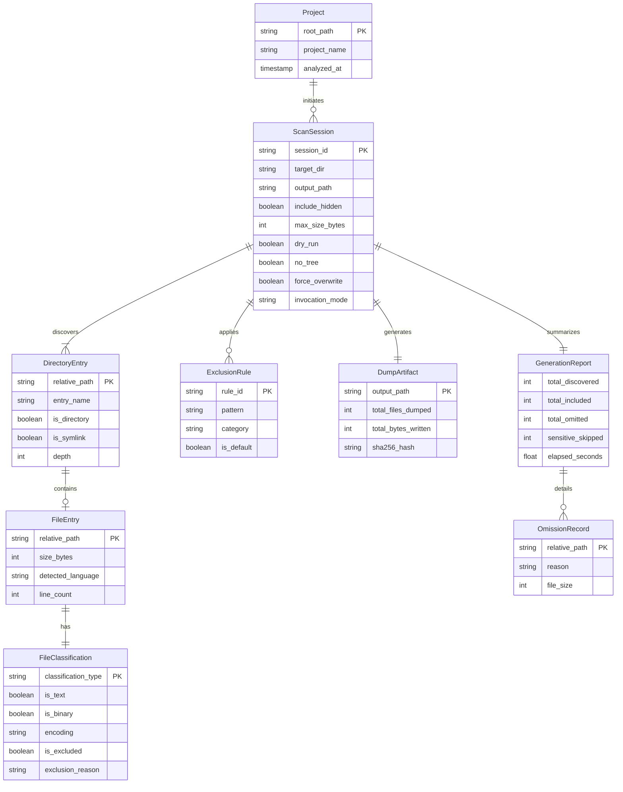
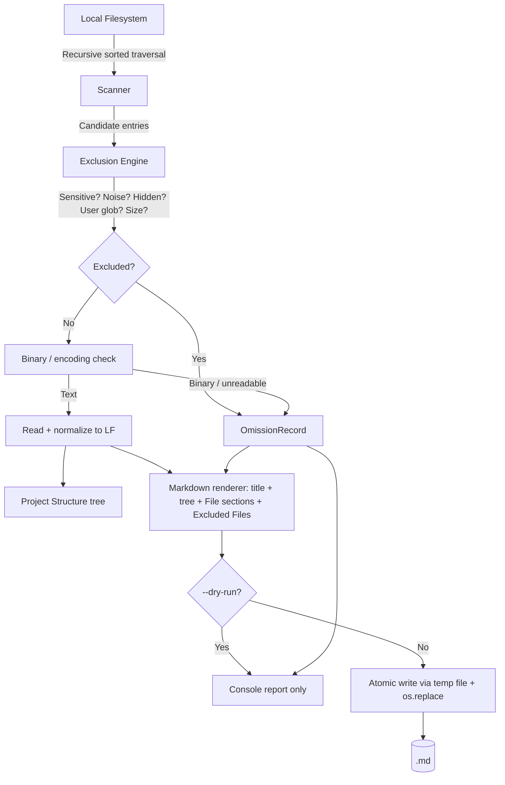

# Entity Relationship Diagram & Data Model: CodeDumper

**Document Version:** 2.0.0
**Status:** Approved
**Author:** Engineering Team
**Source of Truth:** `README.md` + `docs/PRD.md` (v2.0.0)
**File:** `docs/ERD.md`

---

## 1. Persistence Assessment

### 1.1 Evaluated Storage Paradigms

1. **Relational / document database (SQLite, PostgreSQL, …):**
   *Assessment:* Rejected. CodeDumper is a stateless file-to-file CLI; a
   database adds migrations, locks, and dependencies for zero user benefit.
2. **Persistent scan cache / history:**
   *Assessment:* Rejected for MVP. Full deterministic traversal of 1,000 files
   takes <0.5 s; caches risk stale reads.
3. **Local configuration file (`.codedumperrc`):**
   *Assessment:* Deferred (post-MVP "configuration profiles"). Menu option `4`
   keeps patterns session-scoped in memory only.
4. **In-memory scan state:** **Required.** Discovered paths, exclusion
   verdicts, and classifications live in runtime dataclasses for one
   invocation.
5. **Output artifact:** **Required.** The single persistent deliverable is the
   generated Markdown file (`<project>.md`).

### 1.2 Persistence Conclusion

No database is introduced. The pipeline transforms local filesystem entries
into one Markdown artifact, plus console output. (`autocommit`'s own
`autocommit_state.json` is companion-scoped and untouched by this decision.)

---

## 2. Logical Entity Model

Runtime Python dataclasses — **not** database tables.

### 2.1 Entity Notes (materialized in `codedumper/models.py`)

- **Project:** validated root (`exists`, `is_dir`, readable); `project_name`
  = directory base name → default output `<name>.md` (PRD FR-014).
- **ScanSession:** extends the v1 session with `invocation_mode`
  (`menu | dump | legacy`) and `no_tree` / `force_overwrite` flags.
  `max_size_bytes` > 0 enforced; `--max-file-size` is the primary spelling,
  `--max-size` an alias (PRD FR-009/FR-020).
- **ExclusionRule categories:** `SENSITIVE` (unbypassable) · `DEFAULT_NOISE` ·
  `HIDDEN` · `USER_GLOB` (CLI `--exclude` + menu option-4 session patterns).
- **FileEntry:** `content` held transiently for rendering; never persisted
  except inside the output artifact.
- **DumpArtifact:** absent in `--dry-run` (PRD FR-016).
- **GenerationReport:** console counts (`Files discovered/included/excluded`,
  `Sensitive files skipped`) are projections of this entity — always measured,
  never fabricated (PRD FR-017). `elapsed_seconds` is console-only and
  excluded from the Markdown to preserve determinism (PRD NFR-006).

---

## 3. Relationships and Cardinality

1. **Project → ScanSession (1:N):** repeated scans with different flags are
   isolated sessions.
2. **ScanSession → DirectoryEntry (1:N):** entries belong to one session.
3. **DirectoryEntry → FileEntry (1:0..1).**
4. **FileEntry → FileClassification (1:1).**
5. **ScanSession → DumpArtifact (1:0..1):** zero in dry-run.
6. **ScanSession → GenerationReport (1:1)** → **OmissionRecord (1:N).**

---

## 4. Data Flow

Exclusion precedence (normative): **sensitive > default noise > hidden >
user globs > size limit > binary/encoding** (PRD FR-009–FR-013).

---

## 5. Data Integrity and Privacy

1. Relative paths normalized to POSIX (`a/b.py`); `\n` line endings in output.
2. Deterministic sorting at every level; Markdown excludes wall-clock timing.
3. Symlinks never followed; traversal stays within the project root.
4. Exclusion report carries filenames + reasons only — never file contents or
   secret values.
5. Source tree opened read-only; output written atomically beside the
   destination.
