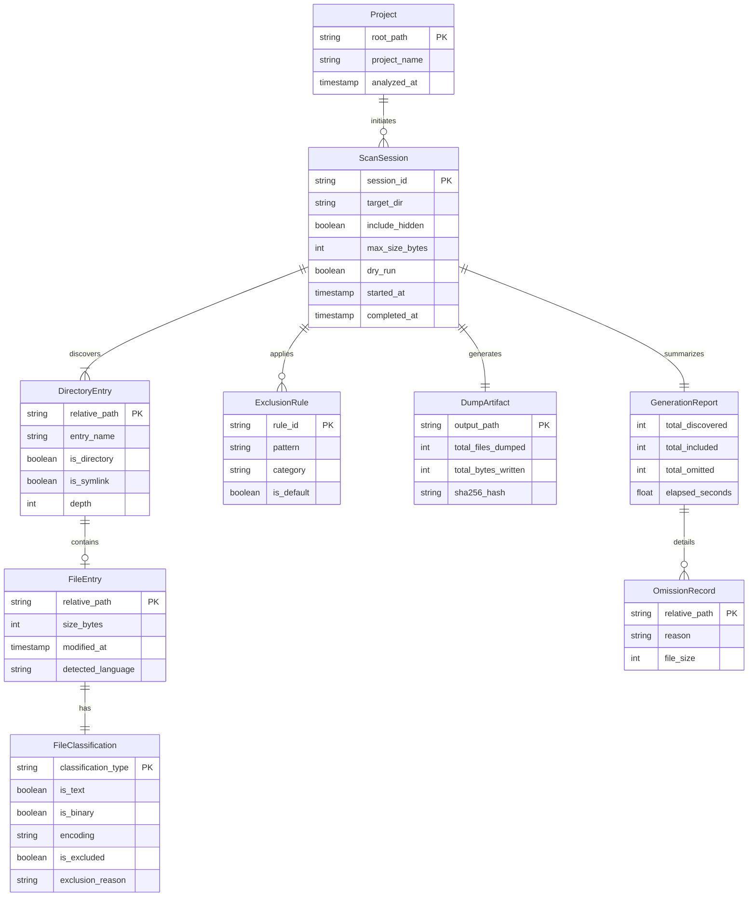
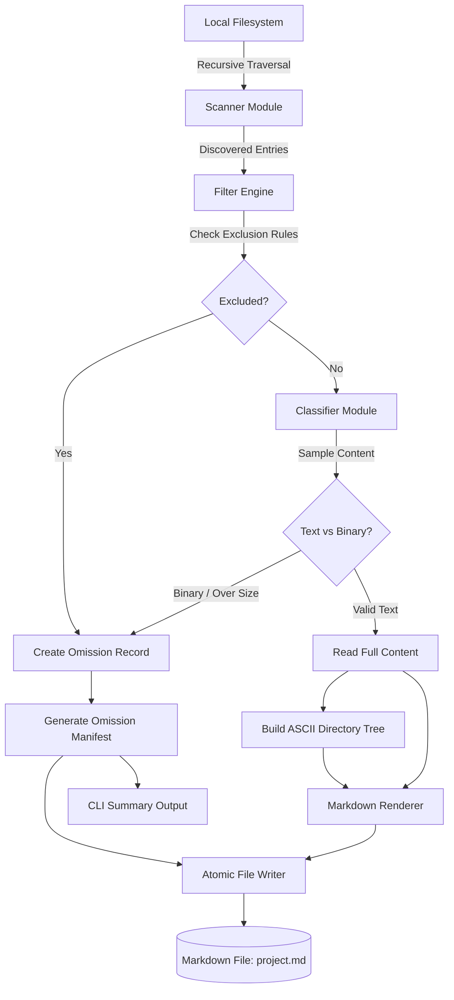

# Entity Relationship Diagram & Data Model: CodeDumper

**Document Version:** 1.0.0  
**Status:** Approved  
**Author:** Engineering Team  
**File:** `docs/ERD.md`  

---

## 1. Persistence Assessment

### 1.1 Evaluated Storage Paradigms
We evaluated five possible persistence models for CodeDumper:
1. **Relational Database (e.g., SQLite, PostgreSQL):**  
   *Assessment:* Unnecessary overhead. CodeDumper is a stateless CLI utility that reads a local directory tree on demand and produces a single output file. Adding SQLite or an ORM introduces disk schema migrations, file lock contention, and binary dependencies without providing any user benefit.
2. **Persistent Scan History / Cache:**  
   *Assessment:* While caching file hashes could accelerate repeated scans, filesystem mtimes are volatile and caching introduces stale-read bugs where modified files might be skipped. For MVP, complete deterministic traversal of 1,000 files takes <0.5 seconds, rendering a disk cache unjustified.
3. **Local Configuration File (`.codedumperrc` / `codedumper.toml`):**  
   *Assessment:* Post-MVP candidate. CLI flags currently provide explicit, reproducible control per invocation without hidden workspace state.
4. **In-Memory Scan State:**  
   *Assessment:* **Required.** The application maintains an in-memory representation of scanned paths, exclusion decisions, and file classifications during the lifecycle of a single CLI invocation.
5. **Output Artifact (Target Markdown Document):**  
   *Assessment:* **Required.** The primary persistent deliverable created on disk is the rendered Markdown file (`<project>.md`).

### 1.2 Persistence Conclusion
The MVP **does not require a relational or document database**. The application operates strictly as an in-memory stream processor transforming local filesystem entries into a single persistent Markdown artifact.

---

## 2. Logical Entity Model

The conceptual and runtime entities defining the application architecture are detailed below. These entities represent runtime Python dataclasses rather than database tables.

### 2.1 Entity Catalog

> [!NOTE]
> The above diagram portrays the logical application data model for runtime objects, not a deployed SQL database schema.

---

### 2.2 Detailed Entity Specifications

#### 1. Project
- **Purpose:** Represents the physical repository root being dumped.
- **Attributes:**
  - `root_path` (`Path`, Required, Identifier): Absolute canonical filesystem path to repository.
  - `project_name` (`str`, Required): Directory base name used as fallback output document name.
  - `analyzed_at` (`datetime`, Required): Timestamp when the scan commenced.
- **Validation:** Must exist, must be a directory, must be accessible with read permissions.
- **Lifecycle:** Created at CLI invocation; discarded upon process termination.

#### 2. ScanSession
- **Purpose:** Encapsulates the execution parameters, configuration flags, and active state of a scan.
- **Attributes:**
  - `session_id` (`str`, Required, UUID4): Unique identifier for logging and debugging.
  - `target_dir` (`Path`, Required): Normalized directory being inspected.
  - `output_path` (`Path`, Optional): Desired location of the output Markdown file.
  - `include_hidden` (`bool`, Required, default=False): Flag to allow dotfiles.
  - `max_size_bytes` (`int`, Required, default=1,048,576): Threshold for file exclusion.
  - `exclude_patterns` (`List[str]`, Required): Compiled list of glob patterns.
  - `force_overwrite` (`bool`, Required, default=False): Overwrite existing output flag.
  - `dry_run` (`bool`, Required, default=False): Omit disk write flag.
- **Validation:** `max_size_bytes` > 0; `target_dir` must resolve to an existing folder.
- **Lifecycle:** Instantiated from parsed CLI options; controls entire processing pipeline.

#### 3. ExclusionRule
- **Purpose:** Represents a filter criteria applied during tree traversal.
- **Attributes:**
  - `rule_id` (`str`, Required): Identifier (e.g., `RULE_DEFAULT_VCS`, `RULE_SECRET_ENV`).
  - `pattern` (`str`, Required): Glob pattern (e.g., `*.pem`, `.git`, `node_modules`).
  - `category` (`Enum[ExclusionCategory]`, Required): `DEFAULT_NOISE`, `SENSITIVE`, `HIDDEN`, `USER_GLOB`.
  - `is_default` (`bool`, Required): Whether the rule is built-in or user-provided.
- **Validation:** Pattern must be a valid glob syntax string.

#### 4. DirectoryEntry & FileEntry
- **Purpose:** Represents individual filesystem nodes discovered during recursion.
- **Attributes (`DirectoryEntry`):**
  - `relative_path` (`str`, Required, Identifier): Normalized relative path using POSIX forward slashes.
  - `entry_name` (`str`, Required): Basename of the file or folder.
  - `is_directory` (`bool`, Required): True if node is a folder.
  - `is_symlink` (`bool`, Required): True if node is a symbolic link.
  - `depth` (`int`, Required): Directory depth relative to project root.
- **Attributes (`FileEntry` extends `DirectoryEntry`):**
  - `size_bytes` (`int`, Required): Size of file in bytes.
  - `modified_at` (`datetime`, Optional): Last modification timestamp.
  - `detected_language` (`str`, Required): Markdown syntax identifier (e.g., `python`, `json`, `text`).

#### 5. FileClassification
- **Purpose:** Captures the content inspection results and exclusion verdicts.
- **Attributes:**
  - `is_text` (`bool`, Required): True if file content is safe text.
  - `is_binary` (`bool`, Required): True if file contains null bytes or binary heuristics.
  - `encoding` (`str`, Required): Resolved character encoding (`utf-8`, `latin-1`).
  - `is_excluded` (`bool`, Required): Final inclusion verdict.
  - `exclusion_reason` (`Optional[str]`): Reason code (`BINARY`, `EXCEEDS_MAX_SIZE`, `SENSITIVE`, `PATTERN`).

#### 6. DumpArtifact
- **Purpose:** Represents the persistent Markdown output file generated on disk.
- **Attributes:**
  - `output_path` (`Path`, Required): Canonical destination path on the filesystem.
  - `total_files_dumped` (`int`, Required): Count of file contents embedded.
  - `total_bytes_written` (`int`, Required): Byte count of generated Markdown document.
  - `sha256_hash` (`str`, Required): Cryptographic digest of the output document for determinism verification.

#### 7. GenerationReport & OmissionRecord
- **Purpose:** Summarizes scanning telemetry and records detailed omission reasons.
- **Attributes:**
  - `total_discovered` (`int`): Count of all nodes encountered.
  - `total_included` (`int`): Files written into the dump.
  - `total_omitted` (`int`): Files skipped.
  - `omissions` (`List[OmissionRecord]`): Collection of path-to-reason mappings.
  - `elapsed_seconds` (`float`): Execution wall clock duration.

---

## 3. Relationships, Cardinality, and Ownership

1. **Project to ScanSession (1 : N):** A project can be scanned multiple times with different flags; each scan creates an isolated `ScanSession`.
2. **ScanSession to DirectoryEntry (1 : N):** A session discovers many entries. Entries belong strictly to their parent session.
3. **DirectoryEntry to FileEntry (1 : 0..1):** A directory entry may specialize into a file entry if it is not a directory.
4. **FileEntry to FileClassification (1 : 1):** Every discovered file receives exactly one classification verdict.
5. **ScanSession to DumpArtifact (1 : 0..1):** A session produces exactly one artifact, unless in `--dry-run` mode.
6. **ScanSession to GenerationReport (1 : 1):** Every session generates an audit report.

---

## 4. Data Flow

1. **Discovery:** Filesystem is traversed recursively in lexicographical order.
2. **Filtering:** Each path is tested against default noise patterns, sensitive regex/globs, and user `--exclude` arguments.
3. **Classification:** Surviving files have their headers sampled (up to 8 KB) to detect null bytes. Size is checked against `max_size_bytes`.
4. **Tree Synthesis:** Surviving and omitted nodes are synthesized into an ASCII directory tree reflecting the hierarchy.
5. **Rendering:** Included files are serialized into Markdown with dynamic multi-backtick fences.
6. **Persistence:** The rendered Markdown is atomically flushed to disk via a temporary file.

---

## 5. Data Integrity and Privacy

1. **Path Normalization:** All relative paths are normalized to POSIX format (`foo/bar.py`) regardless of operating system (Windows `\` converted to `/`).
2. **Deterministic Sorting:** Directory entries are sorted alphabetically with directories preceding files or pure case-insensitive lexicographical sorting, guaranteeing byte-identical output across runs.
3. **Exclusion Precedence:**
   1. Sensitive files (`.env*`, `*.pem`, `*.key`) — **Highest precedence**; cannot be bypassed.
   2. Built-in VCS/build noise (`.git`, `node_modules`).
   3. Hidden files (unless `--include-hidden` is active).
   4. User-specified `--exclude` patterns.
   5. File size limits.
   6. Content classification (binary detection).
4. **Atomic Write Protection:** The dump file is written to a sibling temporary file (`.codedumper_tmp_<pid>`) and renamed via atomic filesystem swap (`os.replace`) to prevent corrupt or partial output files on crash or cancellation.
5. **Read-Only Guarantee:** Source files are opened with mode `rb` and never modified.

---

## 6. Persistence Decision Justification

CodeDumper has no need for relational persistence, an ORM, or a background database server. The file-to-file pipeline is completely stateless and deterministic. A single output file on disk represents the entire durable outcome of the program.
